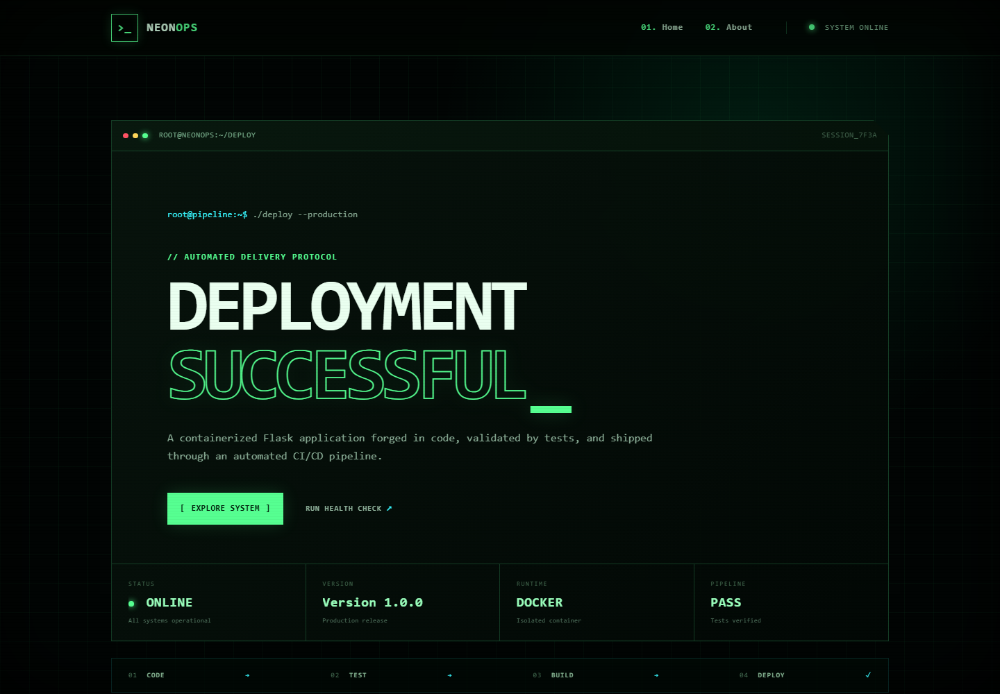
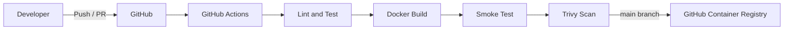

# NeonOps CI/CD Web Application


A portfolio-ready Flask application that demonstrates a secure container workflow and an automated CI/CD pipeline. The responsive interface uses a neon terminal design and displays the current application version and deployment state.

## Preview



## Highlights

- Responsive hacker-inspired NeonOps interface
- Flask application served by Gunicorn
- Docker image running as a non-root user
- Liveness and readiness API endpoints
- Automated pytest and Ruff quality checks
- Container smoke tests and Trivy vulnerability scanning
- Automatic image publishing to GitHub Container Registry (GHCR)
- Weekly Dependabot updates for Python, Docker, and GitHub Actions

## Architecture



## Application endpoints

| Route | Purpose | Response |
| --- | --- | --- |
| `/` | NeonOps dashboard | HTML |
| `/about` | Project and technology overview | HTML |
| `/health` | Liveness and version information | JSON |
| `/ready` | Container readiness check | JSON |

Example health response:

```json
{"status":"healthy","version":"1.0.0"}
```

## Run with Docker

Docker Compose is the simplest way to start the project:

```bash
docker compose up --detach --build
```

Open `http://localhost:5000`, then stop the application with:

```bash
docker compose down
```

Set a custom release version in PowerShell before starting:

```powershell
$env:APP_VERSION = "1.1.0"
docker compose up --detach --build
```

## Local development

Create a virtual environment and install development tools:

```powershell
python -m venv .venv
.\.venv\Scripts\Activate.ps1
pip install -r requirements-dev.txt
flask --app app run --port 5000
```

Run all local quality checks:

```bash
ruff check .
ruff format --check .
pytest
```

## CI/CD pipeline

The workflow runs for pull requests, pushes to `main`, and manual dispatches.

1. Installs cached Python dependencies.
2. Checks linting and formatting with Ruff.
3. Runs the pytest suite.
4. Builds the production Docker image.
5. Starts a container and verifies `/`, `/health`, and `/ready`.
6. Scans the image for critical vulnerabilities with Trivy.
7. Publishes `latest` and commit-SHA tags to GHCR after a successful push to `main`.

The published image will be available as:

```text
ghcr.io/<github-user>/<repository>:latest
```

The workflow uses the built-in `GITHUB_TOKEN`; no registry password needs to be created. Repository Actions must have permission to write packages.

## Security decisions

- The container runs as the unprivileged `appuser` account.
- Production dependencies do not include pytest or Ruff.
- The image exposes a Docker readiness health check.
- Responses include anti-sniffing, frame-denial, and referrer-policy headers.
- Trivy blocks publishing when a fixable critical image vulnerability is found.
- Dependency updates are proposed automatically by Dependabot.

## Project structure

```text
.
|-- .github/
|   |-- workflows/ci.yml
|   `-- dependabot.yml
|-- static/style.css
|-- templates/
|   |-- base.html
|   |-- index.html
|   `-- about.html
|-- tests/test_app.py
|-- app.py
|-- docker-compose.yml
|-- Dockerfile
|-- pyproject.toml
|-- requirements.txt
|-- requirements-dev.txt
`-- README.md
```

## Troubleshooting

- **Port 5000 is busy:** stop the conflicting process or change the host port in `docker-compose.yml`.
- **Container does not become healthy:** run `docker compose logs web` and check `http://localhost:5000/ready`.
- **Python modules are missing:** activate the virtual environment and reinstall `requirements-dev.txt`.
- **GHCR publishing fails:** confirm that repository workflow permissions allow package writes.

## Portfolio talking points

- Designed a responsive Flask dashboard and packaged it as a production Gunicorn container.
- Implemented CI quality gates covering linting, tests, endpoint smoke checks, and vulnerability scanning.
- Automated immutable container publication with commit-SHA tags and supply-chain attestations.
- Reduced the production dependency surface by separating development tooling from runtime packages.

## License

This project is available under the [MIT License](LICENSE).
