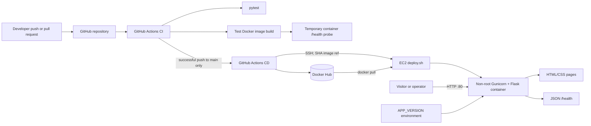

# Software Design Document

**Artifact slug:** `containerized-web-app-cicd-pipeline` (paired RDD: [`containerized-web-app-cicd-pipeline-requirements.md`](./containerized-web-app-cicd-pipeline-requirements.md))  
**Workflow ID:** `c560efe0-973b-4512-81b9-66b879c0dd68`  
**Title:** Automated CI/CD Pipeline for a Containerized Web Application  
**Version:** 1.0  
**Status:** PENDING_APPROVAL  
**RDD reference:** `docs/sdlc/c560efe0-973b-4512-81b9-66b879c0dd68/containerized-web-app-cicd-pipeline-requirements.md`

## 1. System overview

This design creates a small, stateless Flask portfolio application and the delivery path around it. The application factory defines three unauthenticated routes: a modern home page, an About page, and a machine-readable health endpoint. Tests and Gunicorn use the same factory. `APP_VERSION` is the sole application-specific runtime setting and defaults to `1.0.0`, keeping local execution deterministic and production releases traceable without introducing a database or service dependency.

The application is packaged as one non-root Python 3.12 container. GitHub Actions validates every push and pull request to `main` with pytest, an image build, and a live container health probe. A separate CD workflow reacts only to a successful push-based CI run on `main`, builds the exact successful commit once, publishes both immutable commit-SHA and mutable `latest` tags to Docker Hub, and deploys the SHA tag over SSH to a single Ubuntu EC2 host. The host-side script performs an idempotent replacement, bounded health verification, and best-effort rollback to the pre-deployment local image.

The repository remains beginner-oriented: one Python module, two templates plus a shared layout, one stylesheet, one route test module, two workflows, and one deployment script. Documentation explains the architecture, security boundaries, operational limitations, interview talking points, and the distinction between locally verified behavior and external actions that require the owner's real GitHub, Docker Hub, and AWS resources.

### In scope

- Flask application factory, home/About HTML routes, `/health` JSON route, environment-driven version, templates, and CSS.
- Pinned Python runtime and test dependencies; pytest route/version coverage without external calls.
- Non-root production image, Gunicorn, Docker health check, `.dockerignore`, and local Compose path.
- CI for tests, image build, live-container probe, diagnostics, and guaranteed cleanup.
- CI-gated CD publishing `latest` and the successful commit SHA, followed by SSH deployment of the SHA tag.
- Idempotent EC2 deployment with port `80:5000`, bounded health checks, useful diagnostics, and previous-local-image rollback.
- A complete, truthful, beginner-friendly README with setup, operations, troubleshooting, interview questions, and resume bullets.

### Out of scope

- Kubernetes, Terraform, ArgoCD, load balancers, autoscaling, managed container platforms, multiple hosts, or zero-downtime deployment.
- Application authentication, persistent data, queues, background jobs, or domain APIs beyond the three requested routes.
- Provisioning accounts or infrastructure, creating/storing credentials, inventing a Git remote, or claiming live publication/deployment without real external verification.
- HTTPS/TLS termination and a custom domain; these are documented as sensible future production improvements, not implied capabilities.

### Requirements coverage

| FR/NFR ID | Design section | Notes |
|---|---|---|
| FR-1–FR-5 | §§2–6 | Factory-based Flask routes, templates, JSON health, environment version, Gunicorn. |
| FR-6–FR-7 | §§2–3, 5–6 | Non-root Python 3.12 image, health check, ignore file, and Compose. |
| FR-8 | §9 | Isolated pytest coverage for home, health, and version behavior. |
| FR-9 | §§2–3, 6, 9 | Push/PR CI with tests, build, live probe, diagnostics, and cleanup. |
| FR-10, FR-12 | §§2–4, 6 | Successful-main-CI CD, dual tags, SSH deployment, and fail-fast verification. |
| FR-11, FR-13 | §§3–6, 8 | Executable idempotent deploy script, bounded checks, rollback, and first-deploy handling. |
| FR-14 | §§2–4, 7–9 | Five named GitHub Secrets only; no secret values in code, images, docs, or logs. |
| FR-15–FR-16 | §§3, 9–10 | Complete README and explicit small repository structure. |
| NFR-1–NFR-3 | §§2–3, 7–9 | Non-root image, minimal workflow permissions, secret hygiene, and canonical port model. |
| NFR-4–NFR-7 | §§2, 6–9 | Fail-fast automation, cleanup, repeatable deployment, immutable tag, rollback, diagnostics. |
| NFR-8–NFR-10 | §§3, 7–9 | Small readable design, pinned inputs, reproducible commands, network-independent tests. |
| NFR-11–NFR-13 | §§2–3, 6, 9–10 | Python/platform compatibility, consistent ports, and truthful verification language. |

## 1b. Scope options (user selects at SDD approval)

**Scope (choose one — default: Option 1):**

- (x) **Option 1 — Complete requested portfolio baseline** — includes every FR-1–FR-16 and NFR-1–NFR-13 artifact and local verification defined in this SDD; excludes optional lint/security tooling, automated deployment-script fault-injection tests, provisioned cloud resources, and claims of live Docker Hub/AWS success.
- ( ) **Option 2 — Baseline plus automation hardening** — includes Option 1 and adds ShellCheck for `scripts/deploy.sh`, actionlint for both workflows, a secret-pattern scan, and an isolated shell test harness that exercises repeat deployment, failed-health rollback, and no-previous-image behavior with mocked Docker/curl commands; excludes provisioning and live external publication/deployment.
- ( ) **Option 3 — Hardened baseline plus external acceptance run** — includes Option 2 and, only with user-supplied accounts/infrastructure and authorization, runs the pipeline against a real Docker Hub repository and Ubuntu EC2 host and records sanitized evidence; excludes infrastructure-as-code, account creation, TLS, multi-host, and zero-downtime work.

**Cleanup (optional — check to include):**

- [ ] **Remove unused files and dead code** in the affected area (superseded files deleted, orphaned tests/config removed)

> Humanless execution defaults to Option 1. Option 1 is a complete delivery, not a partial implementation; the larger options add verification depth or an authorized external acceptance run.

### Delivery scope table (Option 1)

| Layer | Paths | Create | Modify | Delete | FR/NFR |
|---|---|---|---|---|---|
| HTTP/business | `app.py` | Application factory; `/`, `/about`, `/health`; `APP_VERSION` config | None (greenfield) | None identified | FR-1–FR-5; NFR-8 |
| Presentation | `templates/base.html`, `templates/index.html`, `templates/about.html`, `static/css/style.css` | Shared navigation/layout, responsive home/About content and deployment/version status | None | None identified | FR-1–FR-2, FR-15 |
| Dependencies | `requirements.txt`, `requirements-dev.txt` | Pinned runtime dependencies and pinned pytest development dependency | None | None identified | FR-5, FR-8; NFR-9–NFR-11 |
| Tests | `tests/test_app.py`, `pytest.ini` | Factory fixture, acceptance-critical route/version tests, and a reproducible repository import path for both `pytest` and `python -m pytest` | None | None identified | FR-8; NFR-9-NFR-10 |
| Container/local runtime | `Dockerfile`, `.dockerignore`, `docker-compose.yml` | Non-root image, Gunicorn command, health check, exclusions, local service | None | None identified | FR-5–FR-7; NFR-1, NFR-9, NFR-12 |
| CI/CD | `.github/workflows/ci.yml`, `.github/workflows/cd.yml` | Validation, image publication, SSH delivery, minimal permissions | None | None identified | FR-9–FR-10, FR-12, FR-14; NFR-2, NFR-4, NFR-6–NFR-7 |
| Deployment | `scripts/deploy.sh` | Idempotent pull/replace/health/rollback operations | None | None identified | FR-11–FR-13; NFR-3, NFR-5, NFR-7, NFR-12 |
| Repository hygiene/docs | `.gitignore`, `README.md` | Local exclusions and complete portfolio/operations/interview documentation | None | None identified | FR-14–FR-16; NFR-2–NFR-3, NFR-8–NFR-9, NFR-13 |

### Removal list

No application artifacts currently exist, so Option 1 has no planned deletion. Implementation must still apply remove-on-touch hygiene: if an artifact is replaced while implementing this SDD, delete the superseded file, route, workflow step, config key, or test and remove all references. Do not retain a Flask development-server production path, an alternate deployment script, duplicate health route, placeholder secret, or obsolete container configuration.

## 2. Architecture

### Logical architecture

The runtime is a single Flask/Gunicorn process inside one Docker container. Flask owns both page rendering and the health response; there is no persistence layer. Browser and health clients reach the same internal listener on port 5000. Compose publishes `5000:5000` for local use, while EC2 publishes only host port 80 to container port 5000. `APP_VERSION` is injected when the container starts, so the same image can report the release identity selected by deployment.

Delivery is intentionally separated into validation and release. `ci.yml` is the required check and has no secrets. `cd.yml` starts through `workflow_run` only when the named CI workflow completed successfully for a `push` on `main`; its release job targets a trusted Linux x64 self-hosted runner with controlled egress matching the administrator's SSH `/32` rule, checks out `workflow_run.head_sha`, publishes the same build under `latest` and the full commit SHA, then deploys the SHA image reference. This prevents a pull-request CI completion or a newer unchecked commit from becoming the deployed artifact. CD uses repository secrets only at the step that needs them and declares `contents: read` permissions.

The deployment script is streamed from the exact checked-out commit over SSH into remote Bash and invoked with the immutable image reference and commit SHA as the displayed application version; no persistent script copy is required on EC2. The script captures the currently running container's image ID and `APP_VERSION` before replacement, pulls the requested image, removes any existing named application container, starts the new one, and probes both container state and `http://127.0.0.1/health` on a bounded retry loop. On failure it prints new-container diagnostics without environment dumps, removes the failed container, and restores the prior local image when available.



### Architecture decisions

| ID | Decision | Rationale and consequence | FR/NFR |
|---|---|---|---|
| AD-1 | Keep one `app.py` application factory rather than introduce packages/services. | The behavior is small and stateless; one readable module matches the live MDC and avoids beginner-hostile abstraction. Routes remain thin and deterministic. | FR-1–FR-5; NFR-8 |
| AD-2 | Use `app:create_app()` as the Gunicorn target and import `create_app` in tests. | Production and tests instantiate the identical application; no Flask development server is part of the delivered run path. | FR-1, FR-5, FR-8 |
| AD-3 | Trigger CD via successful `workflow_run` for CI, additionally requiring event `push`, branch `main`, repository identity match, and success. | It creates an explicit validation gate and avoids publishing PR code or a commit other than the one CI checked. | FR-10, FR-12; NFR-4, NFR-6 |
| AD-4 | Build once in CD and attach both `latest` and full-SHA tags; deploy the SHA tag. | Both requested tags refer to identical image content while the deployed release remains immutable and traceable. | FR-10; NFR-6 |
| AD-5 | Use a synchronous, single-host replacement with bounded retries and previous-local-image rollback. | This matches the MDC and remains understandable. It has a brief outage and cannot roll back a first deployment; both limitations are explicit. | FR-11, FR-13; NFR-5, NFR-7 |
| AD-6 | Keep Docker Hub public for the baseline deployment pull path. | The five mandated secrets authenticate publication but are not transmitted to EC2. A private repository would require a separate secure host login design and is an open decision. | FR-14; NFR-2 |
| AD-7 | Use the runner's SSH client, a temporary key file with restrictive permissions, and a populated `known_hosts` file; never disable host checking silently. | It avoids opaque deployment actions and secret logging. In Option 1 the ephemeral runner bootstraps the host key from the named host; independently pinned fingerprints are recommended when available. | FR-12, FR-14; NFR-2 |

### Deployment/runtime notes

- Python runtime: official slim Python 3.12 base image, pinned to an explicit patch/minor tag selected during implementation; dependencies use exact versions.
- Gunicorn binds `0.0.0.0:5000`; one small worker configuration is sufficient for the demonstration workload and can be documented, not tuned speculatively.
- Docker image creates and switches to a dedicated unprivileged user before `CMD`; only `EXPOSE 5000` appears.
- Docker `HEALTHCHECK` uses Python's standard library to call `http://127.0.0.1:5000/health`, avoiding an OS package solely for probing.
- CI and deploy probes have explicit attempt counts and sleep intervals; implementation records those constants near the probe loop for clarity.
- External systems are boundaries only. No design change is made inside GitHub, Docker Hub, or AWS; users configure those services following README instructions.

## 3. Components

| Component | Responsibility | Repo | New/Modified | FR/NFR |
|---|---|---|---|---|
| Flask application factory | Read `APP_VERSION`, initialize Flask, register three deterministic routes, and expose template/version context. | `.` / `app.py` | New | FR-1–FR-4; NFR-8 |
| Jinja page layer | Shared accessible layout/navigation and responsive home/About content; display exact success message and effective version. | `.` / `templates/**`, `static/css/style.css` | New | FR-1–FR-2, FR-15 |
| Gunicorn runtime | Invoke the factory and serve HTTP on internal port 5000. | `.` / `requirements.txt`, `Dockerfile` | New | FR-5–FR-6; NFR-11–NFR-12 |
| Pytest suite | Instantiate the factory with isolated environment/config and assert critical route, JSON, and version behavior; make both supported pytest entry points resolve the repository root. | `.` / `tests/test_app.py`, `requirements-dev.txt`, `pytest.ini` | New | FR-8; NFR-9-NFR-10 |
| Container definition | Produce a cache-efficient, minimal, non-root application image with a native health check. | `.` / `Dockerfile`, `.dockerignore` | New | FR-5–FR-6; NFR-1–NFR-2, NFR-9 |
| Compose service | Start the image locally, publish `5000:5000`, pass `APP_VERSION`, and surface container health. | `.` / `docker-compose.yml` | New | FR-7; NFR-9, NFR-12 |
| CI workflow | Run pytest, build the image, start a temporary container, retry `/health`, print sanitized diagnostics on failure, and always remove the container. | `.` / `.github/workflows/ci.yml` | New | FR-9; NFR-4, NFR-7 |
| CD workflow | Gate on successful push CI, check out the tested SHA, publish dual tags, establish SSH safely, transfer/execute deployment script, and propagate any failure. | `.` / `.github/workflows/cd.yml` | New | FR-10, FR-12, FR-14; NFR-2, NFR-6–NFR-7 |
| EC2 deployment script | Pull immutable image, preserve prior release metadata, replace named container, verify state/health, and roll back when possible. | `.` / `scripts/deploy.sh` | New | FR-11–FR-13; NFR-3, NFR-5, NFR-7, NFR-12 |
| Portfolio guide | Explain architecture, choices, setup, operations, security groups/secrets, rollback, troubleshooting, interviews, resume claims, and verification status. | `.` / `README.md` | New | FR-15–FR-16; NFR-3, NFR-9, NFR-13 |

### Planned repository structure

```text
.
├── .github/workflows/ci.yml
├── .github/workflows/cd.yml
├── scripts/deploy.sh
├── static/css/style.css
├── templates/base.html
├── templates/index.html
├── templates/about.html
├── tests/test_app.py
├── .dockerignore
├── .gitignore
├── Dockerfile
├── docker-compose.yml
├── app.py
├── requirements.txt
├── requirements-dev.txt
├── pytest.ini
└── README.md
```

SDLC artifacts and live `.cursor/project-context/**` files remain present but are not runtime dependencies.

## 4. APIs

The application has no authentication or authorization because it contains no protected business functionality. All endpoints are read-only, accept no body, and do not use credentials. Flask's normal 404/405 responses cover unknown routes and unsupported methods; no custom error framework is needed for the stated scope.

### 4.1 Home page

- **Method / Path:** `GET /`
- **Auth:** None.
- **Request:** No required headers, query parameters, or body.
- **Response:** `200 text/html`; responsive portfolio landing page containing the exact text `CI/CD Deployment Successful` and the effective version from `APP_VERSION` (default `1.0.0`).
- **Errors:** `405` for unsupported methods. A template/rendering defect produces Flask/Gunicorn `500`; no secret or environment dump is rendered.
- **Idempotency / rate limits:** Safe and idempotent GET. No application rate limiter in this single-host portfolio scope.
- **Traceability:** FR-1–FR-3; NFR-8.

### 4.2 About page

- **Method / Path:** `GET /about`
- **Auth:** None.
- **Request:** No required headers, query parameters, or body.
- **Response:** `200 text/html`; concise explanation of the project, delivery pipeline, and technologies with navigation back to home.
- **Errors:** `405` for unsupported methods; `500` for unexpected template/render failure without sensitive debug output.
- **Idempotency / rate limits:** Safe and idempotent GET; no application rate limiter.
- **Traceability:** FR-1, FR-15; NFR-8.

### 4.3 Health endpoint

- **Method / Path:** `GET /health`
- **Auth:** None; callable by Docker, CI, deployment automation, and operators.
- **Request:** No required headers, query parameters, or body.
- **Response:** `200 application/json` with the exact Flask wire body `{"status":"healthy"}` followed by its trailing newline. Host deployment automation uses Bash command substitution, which strips that trailing newline, and then requires the remaining body to equal `{"status":"healthy"}` exactly; it does not normalize body whitespace.
- **Errors:** `405` for unsupported methods. Because the app has no downstream dependency, a live process returns healthy; process/startup failure is observed as connection failure by the caller rather than a fabricated JSON response.
- **Idempotency / rate limits:** Safe and idempotent GET; deliberately cheap and side-effect free.
- **Traceability:** FR-4, FR-9, FR-11–FR-13; NFR-4–NFR-5, NFR-12.

### 4.4 Deployment script command interface

Although not an HTTP API, `scripts/deploy.sh` is an operational interface used by CD:

- **Invocation:** `bash scripts/deploy.sh <image-reference> [app-version]`
- **Inputs:** A non-empty fully qualified Docker image reference (CD supplies `DOCKERHUB_USERNAME/devops-web-app:<full-sha>`) and optional display version (CD supplies the full commit SHA). Validate both before changing the running container.
- **Fixed runtime contract:** Container name `devops-web-app`; publish `80:5000`; inject `APP_VERSION`; restart policy such as `unless-stopped`; do not publish port 5000 on the host.
- **Success:** Exit `0` only after the container is running/healthy and local host `/health` returns HTTP 200 whose command-substituted response body equals `{"status":"healthy"}` exactly.
- **Failure:** Non-zero exit after concise stage-specific diagnostics. If a prior local image exists, success/failure of rollback is explicitly reported; lack of a prior image on first deploy is explicitly reported.
- **Secrets:** The interface accepts no token/private-key arguments and must not print container environment values. Public-image pull is the Option 1 assumption.
- **Traceability:** FR-11–FR-14; NFR-3, NFR-5, NFR-7, NFR-12.

## 5. Data model

There is no database, cache, file-backed application state, migration, PII, or secret persistence. The following transient/configuration records form the only relevant data model.

| Entity | Store | New/Modified | Key fields | Indexes/retention | FR/NFR |
|---|---|---|---|---|---|
| Application configuration | Process environment / Flask config | New | `APP_VERSION` string; default `1.0.0` | Process lifetime; no persistence | FR-2–FR-3; NFR-9 |
| Health representation | Generated response | New | `status="healthy"` | None | FR-4; NFR-5 |
| Release image | Docker Hub + EC2 Docker image cache | New | repository, full commit-SHA tag, `latest` tag, image ID | Registry policy external; prior local image retained at least through deployment attempt | FR-10–FR-13; NFR-5–NFR-6 |
| Running release metadata | Docker container configuration | New | container name, image ID, `APP_VERSION`, `80:5000`, restart policy | Exists for container lifetime; captured before replacement | FR-11, FR-13; NFR-5, NFR-12 |
| CI/CD credentials | GitHub encrypted Secrets | External configuration only | `DOCKERHUB_USERNAME`, `DOCKERHUB_TOKEN`, `EC2_HOST`, `EC2_USERNAME`, `EC2_SSH_KEY` | Managed by GitHub; never copied to repository/image | FR-14; NFR-2 |

No schema migration is applicable. Templates must treat the version as ordinary escaped text. Scripts/workflows must not dump the full process environment, SSH key, Docker token, or `docker inspect` output containing environment configuration.

## 6. Sequence flows

### 6.1 Successful validation, publication, and deployment

```mermaid
sequenceDiagram
  actor D as Developer
  participant G as GitHub
  participant CI as CI workflow
  participant C as Test container
  participant CD as CD workflow
  participant H as Docker Hub
  participant E as Ubuntu EC2 / deploy.sh
  participant A as Flask container

  D->>G: Push commit to main
  G->>CI: Run CI for exact commit
  CI->>CI: Install pinned dependencies and run pytest
  CI->>C: Build and start test image on port 5000
  loop bounded attempts
    CI->>C: GET /health
    C-->>CI: 200 {status: healthy}
  end
  CI->>C: Always remove test container
  CI-->>G: Success
  G->>CD: workflow_run completed (push, main, success)
  CD->>G: Checkout workflow_run.head_sha
  CD->>H: Push same build as :latest and :full-sha
  CD->>E: SSH stream script; execute full-SHA image + version
  E->>H: Pull full-SHA image
  E->>E: Capture prior image ID/version; replace named container
  E->>A: Start non-root image with APP_VERSION and 80:5000
  loop bounded attempts
    E->>A: Check state/health and GET /health
    A-->>E: running/healthy and 200 healthy JSON
  end
  E-->>CD: Exit 0 with sanitized release diagnostics
  CD-->>G: Deployment success
```

### 6.2 Failed deployment with rollback

```mermaid
sequenceDiagram
  participant CD as CD workflow
  participant E as EC2 deploy.sh
  participant N as New container
  participant P as Previous local image

  CD->>E: Deploy immutable image reference
  E->>E: Capture previous image ID and APP_VERSION
  E->>N: Replace container and start new image
  loop bounded health window
    E->>N: Inspect state + GET /health
    N-->>E: unhealthy, exited, or non-200
  end
  E->>N: Print status/recent logs; remove failed container
  alt Previous local image exists
    E->>P: Start prior image with prior version and 80:5000
    E->>P: Run bounded rollback health verification
    P-->>E: Rollback healthy or failed
    E-->>CD: Exit non-zero; report rollback outcome
  else First deployment / image unavailable
    E-->>CD: Exit non-zero; report no rollback image available
  end
  CD-->>CD: Mark workflow failed
```

### 6.3 Browser and health request flow

1. A local visitor connects to Compose host port 5000 or a production visitor connects to EC2 host port 80.
2. Docker forwards the request to Gunicorn on container port 5000.
3. Gunicorn dispatches to the Flask application created by `create_app()`.
4. `/` and `/about` render Jinja templates; `/` receives the configured effective version. `/health` returns an immediate JSON response without an external call.
5. Unsupported paths/methods receive normal Flask 404/405 handling; no debug server or sensitive diagnostics are exposed.

## 7. Risks

| ID | Risk | Impact | Mitigation | Owner phase |
|---|---|---|---|---|
| R-1 | Real Docker Hub/AWS resources and credentials are unavailable during local delivery. | External publication/deployment cannot be proven. | Complete local tests/image/Compose/smoke verification; validate workflow/script structure; README and final report label external steps unverified. | Implementation, QA, documentation |
| R-2 | Mutable `latest` obscures release identity. | Wrong image could be diagnosed or deployed. | Build once with both tags; deploy/log full SHA reference; retain `latest` only because the requirement asks for it. | CD implementation |
| R-3 | First failed deployment has no prior local image. | Automated rollback is impossible. | Detect before replacement, preserve diagnostics, report the condition explicitly, and document manual recovery. | Deployment implementation/test |
| R-4 | Single-host replacement creates downtime. | Brief unavailability even on successful releases. | Minimize bounded replacement flow and state limitation clearly; do not imply zero downtime. | Deployment/docs |
| R-5 | SSH bootstrap or logs expose/undermine credentials or host identity. | Credential theft or man-in-the-middle risk. | Temporary `0600` key file, masked Secrets, no tracing/environment dump, host checking enabled, known-host population documented; recommend independently pinned host fingerprint when available. | CD/security review |
| R-6 | Port or URL drift across five artifacts. | Healthy application appears unavailable. | Canonical model: app/container 5000, local host 5000, EC2 host 80; cross-file QA assertions and smoke checks. | Implementation/QA |
| R-7 | Rollback metadata is incomplete or prior image was pruned. | Restore starts wrong version or fails. | Capture image ID and current `APP_VERSION` before removal; verify local image exists; health-check rollback; never report rollback success without proof. | Deployment implementation/test |
| R-8 | `workflow_run` is mis-filtered. | PR or failed/unrelated code could publish/deploy. | Require named CI, `conclusion == success`, `event == push`, `head_branch == main`, and same repository; checkout exact `head_sha`. | CD implementation/review |
| R-9 | Base/action/dependency versions drift or introduce supply-chain risk. | Reproducibility/security degrade. | Exact Python package pins, explicit Python image tag, official actions at reviewed versions (immutable action SHAs where practical), minimal permissions, documented update procedure. | Implementation/review |
| R-10 | Git is unavailable and no remote is configured. | Commit/push/CI/PR execution is blocked. | Do not invent a remote; install/configure Git and connect the intended repository before Git-dependent phases. Local artifacts remain independently verifiable. | Orchestrator/user setup |

## 8. Edge cases

| Case | Behavior | FR/NFR |
|---|---|---|
| `APP_VERSION` absent | Home page renders `1.0.0`; factory/test behavior is deterministic. | FR-3; NFR-9 |
| `APP_VERSION` present but contains template-sensitive text | Jinja escapes it; no HTML injection. Implementation may normalize empty string to the documented default. | FR-2–FR-3; NFR-2 |
| Unknown route or POST to GET-only endpoint | Standard 404 or 405; no stack trace/debug data in production. | FR-1–FR-4; NFR-2 |
| Dependency installation/test failure | CI stops before image build or release; non-zero status identifies stage. | FR-8–FR-10; NFR-4, NFR-7 |
| Test container never starts or `/health` never succeeds | Bounded probe fails; status/recent logs are printed; cleanup runs under an always/finally path. | FR-9; NFR-4, NFR-7 |
| Duplicate/re-run CI | Validation is read-only except uniquely named temporary container/image; cleanup makes reruns safe. | FR-9; NFR-4 |
| Duplicate/re-run deployment of same image | Existing named container is captured and replaced cleanly; same immutable image can be redeployed without name conflicts. | FR-11; NFR-5 |
| Invalid/empty deployment arguments | Script exits before pull/removal and prints usage without secrets. | FR-11; NFR-5, NFR-7 |
| Docker pull or SSH connection fails | CD/deploy exits non-zero before destroying the existing healthy container where possible. | FR-11–FR-12; NFR-5, NFR-7 |
| Existing named container is stopped | Its locally available image/version can still be captured if inspectable; replacement remains idempotent. | FR-11, FR-13; NFR-5 |
| Port 80 is already occupied | New container start fails; script prints sanitized Docker diagnostics and attempts prior-image restoration, which may also fail until the conflict is resolved. | FR-11, FR-13; NFR-7, NFR-12 |
| New container is running but the body differs from `{"status":"healthy"}` or HTTP is non-200 | Treat as failed health without normalizing body characters; attempt rollback. This includes malformed values such as `{"status":"heal thy"}`. | FR-4, FR-13; NFR-5 |
| Failed new release with previous image | Remove failed container, run previous image ID with prior version/ports, probe it, report rollback result, and still return non-zero so CD records release failure. | FR-13; NFR-5, NFR-7 |
| Failed first release | State clearly that no previous image exists; leave failed container removed and return non-zero. | FR-13; NFR-5, NFR-7 |
| Rollback image exists but rollback health fails | Report both original deployment and rollback failures with recent safe logs; return non-zero. | FR-13; NFR-5, NFR-7 |
| Pull request CI succeeds | Does not activate CD because CD requires the completed CI run's original event to be `push` on `main`. | FR-10, FR-12; NFR-4 |
| Missing/invalid GitHub Secret | Relevant CD stage fails without echoing secret values; CI remains usable without secrets. | FR-10, FR-12, FR-14; NFR-2, NFR-7 |
| Private Docker Hub repository | Baseline EC2 pull cannot authenticate because registry credentials are intentionally not sent to the host; user must choose a separate approved private-registry design. | FR-14; NFR-2 |

## 9. Testing strategy

| Layer | Approach | Tools / commands | FR coverage |
|---|---|---|---|
| Unit/route | Factory fixture/client verifies `/`, `/about`, `/health`, default version, overridden version, status codes, exact health semantics, and visible success text. No network calls. | `pytest`; focused: `pytest tests/test_app.py` | FR-1–FR-4, FR-8 |
| Runtime/container | Build image; inspect configured user/port/health check; start on local port 5000 with version override; probe pages/JSON; verify process is Gunicorn and container reaches healthy. | `docker build -t devops-web-app:test .`; `docker image inspect`; `docker run`; `curl`/PowerShell equivalent; `docker logs` | FR-2–FR-6; NFR-1, NFR-9, NFR-11–NFR-12 |
| Compose | Render config, start detached, wait/probe, then tear down; confirm `5000:5000` and default/overridden version. | `docker compose config`; `docker compose up -d --build`; `docker compose ps`; `docker compose down` | FR-7; NFR-9, NFR-12 |
| CI contract | Review triggers/permissions and run its substantive commands locally. In GitHub, a failing pytest/build/probe must fail and the temporary container must be absent afterward. | `pytest`; Docker build/run/probe/remove; GitHub Actions run when remote exists | FR-9, FR-14; NFR-2, NFR-4, NFR-7 |
| CD contract | Static review verifies successful-push-main filters, exact `head_sha` checkout/tag/deploy, two tags from one build, minimal permissions, five secret references, strict failure propagation, and no secret output. External run only when authorized resources exist. | Workflow review; GitHub Actions run with configured Secrets when available | FR-10, FR-12, FR-14; NFR-2, NFR-6–NFR-7, NFR-13 |
| Deployment script | Parse check plus controlled Docker-host smoke: repeat deployment, bad image/pull, unhealthy image, previous-image rollback, first-deploy failure, occupied port, and diagnostics. Option 1 may use manual/local Docker scenarios; Option 2 automates mocks/fault injection. | `bash -n scripts/deploy.sh`; `bash scripts/deploy.sh <local-test-image> <version>` on Linux-compatible Docker host | FR-11–FR-13; NFR-3, NFR-5, NFR-7, NFR-12 |
| Documentation/security | Cross-check every required README topic, 20+ interview Q&As, 3–4 truthful resume bullets, canonical ports, no unsupported success claims, no credentials/private keys, and no unnecessary/dead files. | Manual checklist; repository search/secret scan where available | FR-14–FR-16; NFR-2–NFR-3, NFR-8–NFR-9, NFR-13 |
| Regression | Re-run full pytest and local container/Compose smoke after workflow/script/docs changes; confirm no dangling or duplicate paths. | `pytest`; `docker build -t devops-web-app:test .`; Compose smoke | FR-1–FR-16 |

### Acceptance and verification checklist

- [ ] `pytest` passes from a fresh environment with `requirements-dev.txt`; tests make no external calls and cover home, About, health JSON, success text, default version, and overridden version.
- [ ] `docker build -t devops-web-app:test .` succeeds with cache-friendly dependency layers; inspection shows a non-root runtime user, only port 5000 exposed, Gunicorn factory command, and Docker health check.
- [ ] A local test container reaches healthy, returns HTTP 200 from all three routes, returns healthy JSON, and displays the injected version; cleanup removes it.
- [ ] `docker compose up -d --build` makes the app available at `http://localhost:5000`; `docker compose down` cleanly removes local runtime resources.
- [ ] CI triggers for push/PR to `main`, declares least privilege, fails each required stage correctly, prints safe failure context, and removes its test container even after a failed probe.
- [ ] CD can activate only after successful push CI on `main`, checks out the tested SHA, publishes `latest` and the full SHA from one build, deploys the SHA reference, and fails on registry, SSH, deployment, or health error.
- [ ] Only the five named GitHub Secrets are referenced for credentials; no real/fake production credential, private key, token, or secret value appears in repository content, image layers, or logs.
- [ ] `scripts/deploy.sh` is executable in Git, passes `bash -n`, uses `set -Eeuo pipefail`, quotes expansions, validates input before mutation, is repeatable, publishes only `80:5000`, and verifies bounded container/HTTP health with exact response-body comparison that rejects malformed JSON.
- [ ] Failed health with a previous local image attempts and verifies rollback; first-deployment failure says no previous image is available; both release failures return non-zero.
- [ ] README includes overview, Mermaid architecture, technology rationale, local/Python/Docker/test instructions, CI/CD behavior, Docker Hub setup, beginner Ubuntu EC2/Docker setup, security-group rules, source of each Secret, deployment/rollback, troubleshooting, at least 20 project-specific interview Q&As, and 3–4 truthful resume bullets.
- [ ] README and final verification distinguish locally demonstrated results from unexecuted Docker Hub/AWS operations; no external success is claimed without sanitized evidence.
- [ ] Repository review finds no duplicate deployment path, Flask development-server production path, dead code, obsolete config, dangling references, or artifact outside the approved scope.

## 10. Appendix

### Jira

_(Epic ID after Jira agent; Jira is disabled in the live project context.)_

### Open questions and recommended decisions

| Question | Recommended/default decision | Effect if changed |
|---|---|---|
| What GitHub remote will be used? | Do not invent one; initialize/connect `main` when the owner supplies it. | Git-dependent pipeline/PR phases remain blocked until configured. |
| Is Docker Hub repository public or private? | Public for Option 1, so EC2 pulls without receiving registry credentials. | Private requires a separate approved credential delivery/login/logout design on EC2. |
| What EC2 host/user/region/architecture/admin IP apply? | Supply only through external configuration; use an Ubuntu architecture compatible with the built image; restrict SSH to the actual admin IP. | README commands may need architecture/user adjustment; values never enter source. |
| How should CD depend on CI? | `workflow_run` after successful push-based `CI` on `main`, with exact SHA checkout. | A single combined workflow is possible but reduces separation and changes required gating/review details. |
| Which tag is deployed? | Full commit-SHA tag; also publish `latest`. | Deploying `latest` weakens release and rollback traceability. |
| Is an independently pinned SSH host fingerprint available? | Use it when available; Option 1 keeps host checking enabled and documents bootstrap limitations. Never use `StrictHostKeyChecking=no`. | A new approved secret/config mechanism may be needed for stronger pinning. |
| What exact pins should be used? | During implementation, select mutually compatible current stable patch versions for Python 3.12, Flask, Gunicorn, pytest, and official actions; record exact package pins and reviewed action refs. | Pin changes require rerunning the full verification checklist. |

None of these questions blocks the Option 1 design because the listed defaults preserve local completeness and honestly isolate external configuration.

### Reference files reviewed

- `docs/sdlc/c560efe0-973b-4512-81b9-66b879c0dd68/containerized-web-app-cicd-pipeline-requirements.md`
- `.cursor/project-context/project.mdc`
- `.cursor/project-context/architecture.mdc`
- `.cursor/project-context/coding-standards.mdc`
- `.cursor/project-context/deployment.mdc`
- `.cursor/project-context/business-flows.mdc`
- `.cursor/project-context/README.md`
- `.cursor/sdlc-system/state/c560efe0-973b-4512-81b9-66b879c0dd68.json`
- SDLC `sdd-template.md` and `complete-delivery.md`

### Out-of-scope confirmation

Implementation must not add Kubernetes, Terraform, ArgoCD, a database, application authentication, a second deployment mechanism, account/infrastructure provisioning, real secrets, TLS claims, or zero-downtime claims. External Docker Hub publication and EC2 deployment remain documented-but-unverified unless Option 3 is selected and the user supplies and authorizes the necessary systems.
